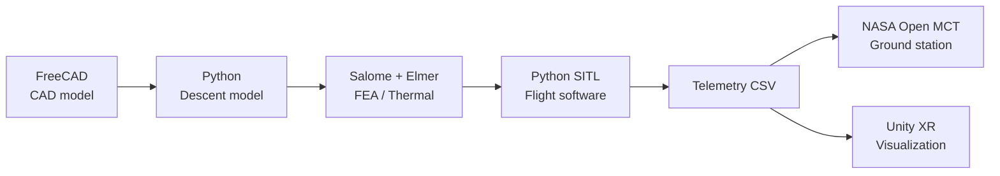

# CanSat HAB Digital Twin

A fully virtual design, simulation and XR visualization pipeline for a high-altitude
balloon-deployed PocketQube CanSat built to the AAS CanSat 2027 architecture.
No physical hardware is built or tested; every stage — from geometry to flight software
to ground station display — lives in this repository and runs in simulation.
The mission is adapted to a 25 km balloon release instead of the standard rocket drop.

---

## Mission profile

1. Balloon ascent to **25 km** release altitude
2. Container released — descends at **10 ± 3 m/s** under parachute
3. PocketQube separates at **90 % of peak altitude (~22.5 km)**
4. Solar panels deploy, **220 mm magnetometer boom** extends, nadir video begins
5. PocketQube lands at **3–5 m/s**; container lands at **10 ± 3 m/s**

---

## Pipeline



---

## Repository structure

| Folder | Contents | Owner |
|---|---|---|
| `docs/` | Proposal, requirements, meeting notes, final report | Mustafa Kayaküçük |
| `params/` | Shared mission parameters (`mission_params.yaml`) | Mustafa Kayaküçük |
| `cad/` | FreeCAD models (`.FCStd`) and exports (`.step`, `.obj`, `.fbx`) | Ege Tamsöz |
| `descent/` | Python descent & parachute model | Hüseyin Bilek, Caner Kocabaş |
| `analysis/structural/` | Salome meshes + Elmer structural/aerodynamic cases | Caner Kocabaş, Ege Tamsöz |
| `analysis/thermal/` | Elmer thermal simulation cases | Hüseyin Bilek |
| `flight_software/` | Python SITL state machine and telemetry generator | Deniz Gürkan |
| `telemetry/` | Generated telemetry CSV files + format spec | Deniz Gürkan |
| `ground_station/` | NASA Open MCT setup and plugins | Mehmet Mert Eser |
| `xr/` | Unity XR project root | Furkan Tagil |
| `tools/` | Shared utility scripts (VTK → Unity, format checks) | Mehmet Mert Eser |

---

## Team

| Name | Discipline | Role |
|---|---|---|
| Mustafa Kayaküçük | Industrial Engineering | Project management & requirements |
| Ege Tamsöz | Mechanical Engineering | CAD & structural analysis |
| Hüseyin Bilek | Aerospace Engineering | Descent model & thermal analysis |
| Caner Kocabaş | Aerospace Engineering | Structural FEA & wind loads |
| Deniz Gürkan | Computer Engineering | Flight software & telemetry |
| Mehmet Mert Eser | Software Engineering | Ground station & data pipeline |
| Furkan Tagil | Software Engineering | Unity XR visualization |

---

## Getting started

### Prerequisites

| Tool | Minimum version | Purpose |
|---|---|---|
| [Git](https://git-scm.com) | 2.40+ | Version control |
| [Git LFS](https://git-lfs.com) | 3.0+ | Large file storage |
| Python | 3.11+ | Descent model, SITL, tools |
| [FreeCAD](https://www.freecad.org) | 0.21+ | CAD modelling |
| [Salome](https://www.salome-platform.org) | 9.x | FEA meshing |
| [Elmer FEM](https://www.elmerfem.org) | 9.x | FEA / thermal solver |
| [Unity Hub + LTS Editor](https://unity.com/download) | 2022 LTS | XR visualization |
| [Node.js](https://nodejs.org) | 20 LTS | NASA Open MCT |

### Clone

```bash
# 1. Install Git LFS (once per machine — see CONTRIBUTING.md for all platforms)
git lfs install

# 2. Clone
git clone https://github.com/dnzgrkn/cansat-hab-digital-twin.git
cd cansat-hab-digital-twin

# 3. Pull any LFS objects
git lfs pull
```

If you will work on the Unity project (`xr/`), also configure **UnityYAMLMerge**
as described in [CONTRIBUTING.md](CONTRIBUTING.md).

---

## Contributing

See [CONTRIBUTING.md](CONTRIBUTING.md) for the branch workflow, commit style,
shared-parameters policy, Git LFS setup, and UnityYAMLMerge configuration.

---

FENG 497 – Section 40 – Izmir University of Economics – Fall 2026.
Supervisor: Fabrizio Pinto.
